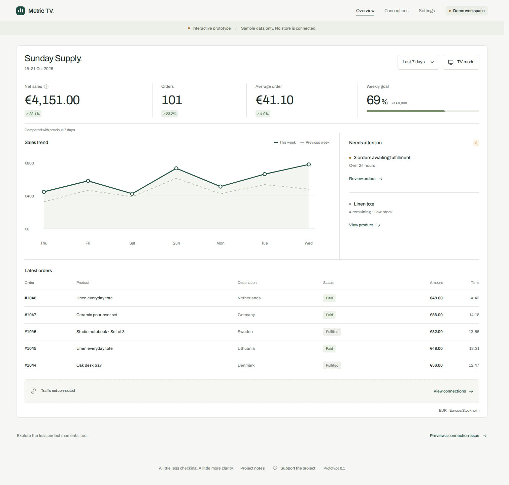
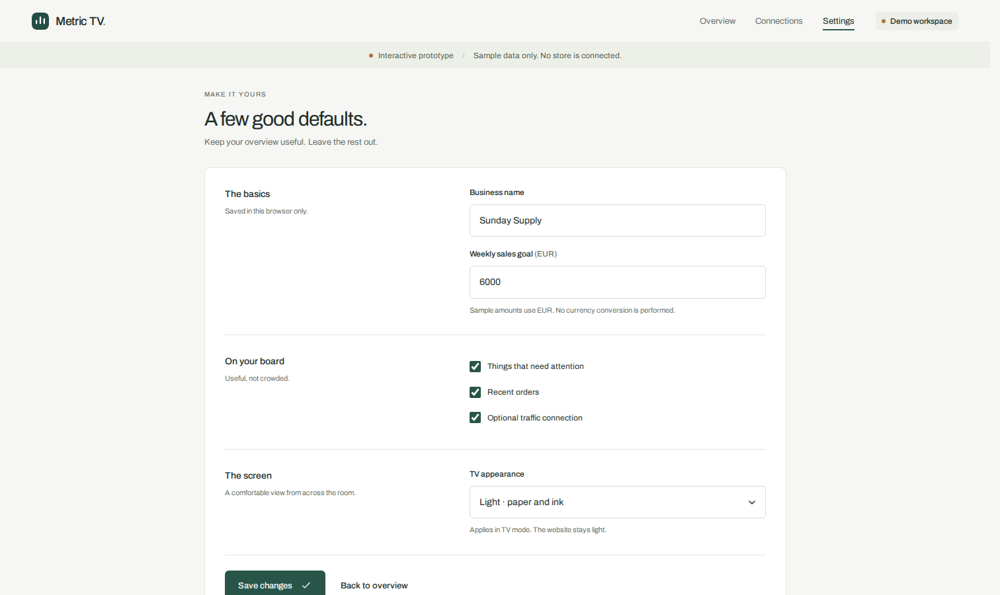

# Selloview

A read-only Shopify dashboard for TVs. See sales, orders, trends and stock alerts without opening Shopify admin.

**Early beta:** hosted access is invite-only. Self-hosting currently supports one configured store and one connecting owner per instance.



*Fictional Sunday Supply store. No real merchant data appears in these screenshots.*

## What works

- Email-code sign-in and read-only Shopify authorization.
- Sales and order metrics with previous-period comparisons.
- TV pairing using a short code. The TV gets a separate, revocable display session, not the owner's login or Shopify credentials.
- Saved period and theme settings, with automatic refresh while the board is open.
- A visible warning when the latest sync fails.

## Run the demo

Requires **Node.js 22.16+**. The demo uses fictional data and needs no Shopify account or dependencies.

```sh
git clone https://github.com/Lufisz/selloview.git
cd selloview
npm start
```

Open **http://127.0.0.1:4317**.

The demo's connection setup is simulated. Its preferences are stored in your browser, not connected to a real store.

<details>
<summary>Screenshot: demo settings</summary>



These are prototype controls. Connected workspaces currently save period and theme; the demo's section toggles and weekly goal are not available there yet.

</details>

## Connect your own store

Follow the **[self-hosting guide](docs/self-hosting.md)**. You need:

- A server running Node.js, with an HTTPS reverse proxy.
- A Shopify app configured for your store.
- A Resend account and verified sending domain for login codes.

The guide covers configuration, owner invitations, Shopify authorization, TV pairing and backups. Example configuration is in [`.env.example`](.env.example); deployment examples are in [`deploy/`](deploy/).

**Current limits:** public merchant onboarding, self-service account deletion, uninstall/privacy webhooks and custom layouts are not ready. Operators can remove accounts through the admin command. A clean-server installation and restore still need verification before a supported release.

## Development

Plain JavaScript, HTML and CSS, with Node.js and SQLite. No frontend framework or build step.

```sh
npm ci --ignore-scripts
npm run check
npm test
```

See [Architecture](docs/architecture.md) for the code structure, [Testing](docs/testing.md) for test guidance, and [Contributing](CONTRIBUTING.md) before opening a pull request.

Report vulnerabilities privately as described in [Security](SECURITY.md). Never include real store data or credentials in issues or screenshots.

## Licence

[AGPL-3.0-only](LICENSE). The bundled Archivo font uses the [SIL Open Font License](public/fonts/OFL.txt).
