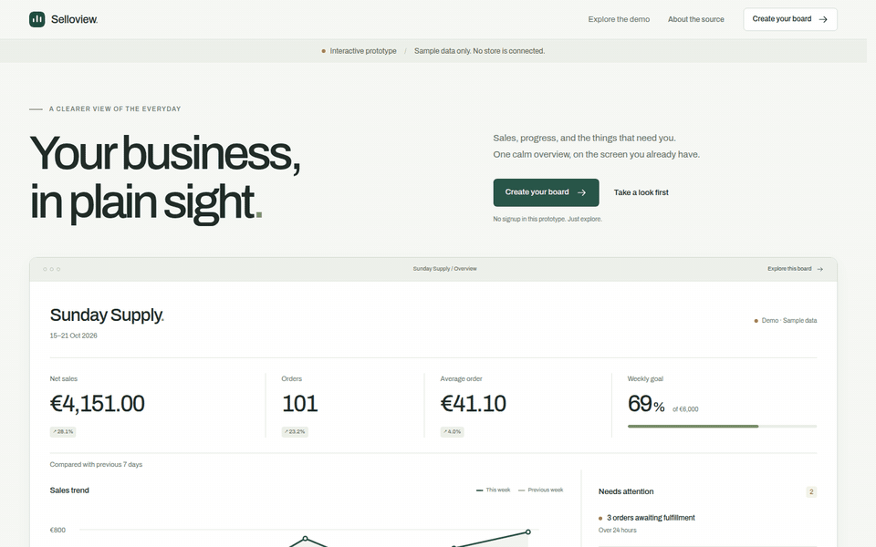
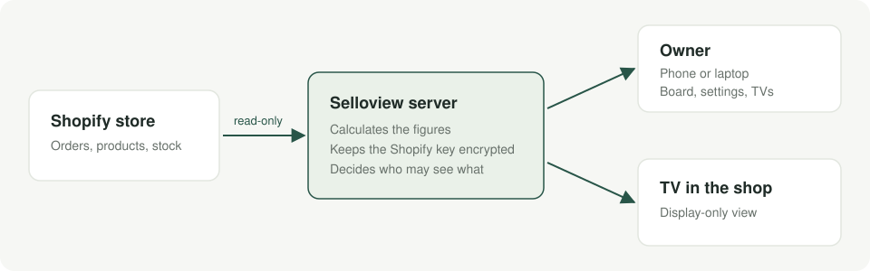
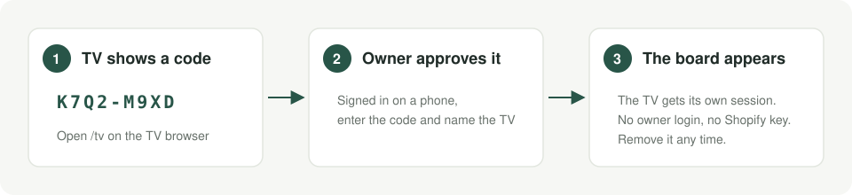
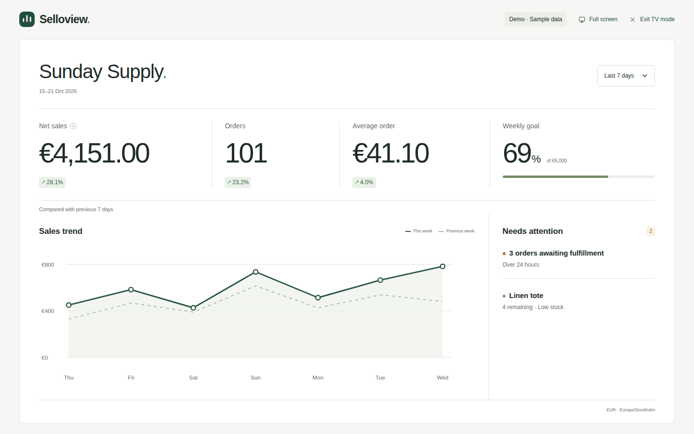

# Selloview

A calm Shopify dashboard for the TV in your shop or office. Sales, orders, trends and what needs attention, on one screen, without opening Shopify admin.



*The sample store "Sunday Supply" is fictional. No real merchant data appears anywhere in this repository.*

## How it works



- **Read-only.** Selloview asks Shopify for four read scopes and never writes to the store.
- **The server does the work.** It calculates the figures and keeps the Shopify key encrypted. Browsers never see it.
- **The TV only gets what it shows.** No customer data, no store address, no admin links, no credentials.

## Pairing a TV



No typing passwords on a TV remote. Each TV gets its own session that the owner can remove at any time.

## What you see

| On a laptop | On the TV |
| --- | --- |
|  |  |

## Try it

Requires **Node.js 22.16+**. The sample uses fictional data and needs no Shopify account.

```sh
git clone https://github.com/Lufisz/selloview.git
cd selloview
npm start
```

Open **http://127.0.0.1:4317**. `npm run build:demo` builds the same sample as plain static files for any static host.

## Connect your own store

Follow the **[self-hosting guide](docs/self-hosting.md)**. You need a server with Node.js behind HTTPS, a Shopify app for your store, and a [Resend](https://resend.com) account for sign-in codes.

**Status: early beta.** One instance serves one store and one owner. Public onboarding, uninstall and privacy webhooks, and self-service account deletion are not built yet.

## Built with

Plain JavaScript, HTML and CSS on Node.js and SQLite. No frontend framework, no build step, two runtime dependencies. 470+ tests run on every change.

```sh
npm ci --ignore-scripts
npm run check
npm test
```

Start with [Architecture](docs/architecture.md), then [Contributing](CONTRIBUTING.md). Report security issues privately as described in [Security](SECURITY.md).

## Licence

[AGPL-3.0-only](LICENSE). The bundled Archivo font uses the [SIL Open Font License](public/fonts/OFL.txt).

The licence covers the code, not the brand. The Selloview name and logo are not part of it: if you run your own version, please give it a different name and logo.
